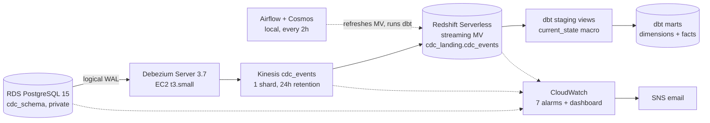

# PostgreSQL to AWS CDC Analytics

An end-to-end change data capture (CDC) pipeline that streams inserts, updates, and
deletes from PostgreSQL into Amazon Redshift, then builds analytics models with dbt.
Debezium Server reads the database's write-ahead log and publishes to Kinesis, and
Terraform deploys everything as a short-lived stack monitored with CloudWatch.

The project began on Snowflake and Kafka. That version is preserved at tag
[`snowflake-final`](https://github.com/saifallah1234/real-time-sales-analytics-pipeline/tree/snowflake-final);
see [Legacy Snowflake path](#legacy-snowflake-path).

## What this project demonstrates

- Infrastructure as code with Terraform: VPC, EC2, RDS, Kinesis, Redshift Serverless,
  IAM, SNS, and CloudWatch.
- PostgreSQL logical replication with `pgoutput` and Debezium Server, covering twelve
  sales and fintech tables.
- One ordered event stream, with Redshift streaming ingestion into a materialized view.
- Rebuilding current state from raw events in dbt, including hard deletes.
- dbt staging, intermediate, dimension, and fact models, with ledger invariant tests.
- Airflow orchestration of dbt through Astronomer Cosmos.
- Pipeline alarms designed around how each component actually fails.
- Cost control: no NAT gateway, capped Redshift capacity, and a usage limit.

## Architecture



### Data flow

1. A change commits in `cdc_schema` on RDS and is written to the logical WAL.
2. Debezium reads the replication slot, flattens each event, and adds `__op`,
   `__table`, `__lsn`, `__source_ts_ms`, and `__deleted`.
3. Every table is routed to the single Kinesis stream `cdc_events`. One shard keeps
   all changes in commit order.
4. `dbt_dag` refreshes the streaming materialized view, which stores each event as a
   `SUPER` payload. Refreshing on a schedule instead of using auto refresh avoids
   keeping Redshift Serverless billing all the time.
5. Staging views keep the newest event per primary key, ordered by LSN, and drop keys
   whose newest event is a delete.
6. dbt builds the intermediate and mart models and runs the tests.

### Tables and models

| Domain | Source tables |
|---|---|
| Sales and inventory | `customer`, `supplier`, `product`, `sales_invoice`, `sales_invoice_item`, `purchase_bill`, `purchase_bill_item`, `inventory_movement` |
| Fintech | `account`, `card`, `financial_transaction`, `ledger_entry` |

dbt builds 12 staging views, 2 intermediate views, and 6 dimension and 7 fact tables.
Two singular tests check that the ledger balances.

## Deploy on AWS

### Prerequisites

- Terraform 1.11 or newer, and the AWS CLI with the Session Manager plugin.
- An AWS profile allowed to create the resources in `deploy/aws/terraform/`.
- `psql`, and the Astro CLI to run Airflow locally.

### 1. Create the stack

Create a git-ignored `deploy/aws/terraform/terraform.tfvars`:

```hcl
my_ip       = "<your public IP>/32"   # allowed to reach Redshift on 5439
alert_email = "<your email>"          # receives alarm emails
```

Then apply it, and click the SNS confirmation email that arrives:

```bash
cd deploy/aws/terraform
terraform init
terraform apply
```

**The stack bills until you destroy it.** See [Tear down](#6-tear-down).

### 2. Load the source database

Connect to the EC2 instance. It has no inbound rules, so this uses Session Manager:

```bash
aws ssm start-session --target "$(terraform output -raw debezium_instance_id)"
```

Inside the session, with `db_address` and `db_password` from `terraform output -raw`:

```bash
cd ~
sudo dnf install -y postgresql15 git
git clone https://github.com/saifallah1234/real-time-sales-analytics-pipeline.git
cd real-time-sales-analytics-pipeline/postgres/init
export PGHOST='<db_address>' PGPASSWORD='<db_password>' PGUSER=postgres

for f in 01_init 02_synthetic_data 03_add_updated_at 05_finance 06_finance_data; do
  psql -d postgres -v ON_ERROR_STOP=1 -f "$f.sql" || { echo "FAILED: $f"; break; }
done

psql -d cdc_project -c "GRANT rds_replication TO saif;" \
                    -c "CREATE PUBLICATION dbz_publication FOR TABLES IN SCHEMA cdc_schema;"
```

`01_init.sql` can't run twice, so don't re-run the loop after a partial failure.

### 3. Start Debezium

Debezium fails to connect until the database exists, and it can stay stuck after that
failure while the service still reports `active`. Restart it, then confirm that
`debezium_slot` shows `active = t`:

```bash
sudo systemctl restart debezium
psql -d cdc_project -c "SELECT slot_name, active FROM pg_replication_slots;"
```

Logs are at `sudo journalctl -u debezium`.

### 4. Create the streaming view

Run this from your machine, with the password from
`terraform output -raw redshift_password` in `PGPASSWORD`. Use the ARN from
`terraform output -raw redshift_kinesis_role_arn`:

```bash
psql "host=$(terraform output -raw redshift_endpoint) port=5439 dbname=dev user=admin sslmode=require"
```

```sql
CREATE EXTERNAL SCHEMA kinesis_schema FROM KINESIS IAM_ROLE '<redshift_kinesis_role_arn>';
CREATE SCHEMA cdc_landing;

CREATE MATERIALIZED VIEW cdc_landing.cdc_events AUTO REFRESH NO AS
SELECT approximate_arrival_timestamp, json_parse(kinesis_data) AS payload
FROM kinesis_schema."cdc_events"
WHERE can_json_parse(kinesis_data);
```

If port 5439 doesn't respond, your public IP has probably changed. Update `my_ip` and
apply again.

### 5. Run dbt through Airflow

Install the dbt packages once after cloning. The Airflow tasks skip `dbt deps` and use
the git-ignored `dbt_packages/` folder:

```bash
uv run --project airflow_astro/dags/ingestion_logic dbt deps --project-dir airflow_astro/dags/dbt/cdc_analytics
```

Set the connection in the git-ignored `airflow_astro/.env`. The password changes every
time the stack is recreated:

```bash
AIRFLOW_CONN_REDSHIFT_CONN='redshift://admin:<password>@<redshift_endpoint>:5439/dev'
```

Start Airflow from `airflow_astro/` with `astro dev start`, open
<http://localhost:8080>, and unpause `dbt_dag`. At least one run must happen within
Kinesis's 24-hour retention, or events are lost.

To run dbt without Airflow, use a Redshift `cdc_analytics` profile in
`~/.dbt/profiles.yml`, and refresh the view first:

```bash
uv run --project airflow_astro/dags/ingestion_logic dbt run-operation refresh_landing --project-dir airflow_astro/dags/dbt/cdc_analytics
uv run --project airflow_astro/dags/ingestion_logic dbt build --project-dir airflow_astro/dags/dbt/cdc_analytics
```

### 6. Tear down

Pause `dbt_dag`, run `astro dev stop`, then:

```bash
cd deploy/aws/terraform
terraform destroy
terraform state list | wc -l   # should print 0
```

## See a change flow through

Run this in the EC2 session, then trigger `dbt_dag`:

```bash
psql -d cdc_project <<'SQL'
INSERT INTO cdc_schema.customer (customer_id, first_name, last_name, email, phone_number)
VALUES (990001, 'CDC', 'Demo', 'cdc.demo@example.com', '+21600000001');
UPDATE cdc_schema.customer SET first_name = 'Updated' WHERE customer_id = 990001;
SQL
```

```sql
SELECT customer_id, first_name FROM analytics_staging.stg_customer WHERE customer_id = 990001;
-- Expected: one row with first_name = 'Updated'
```

Delete the row and trigger `dbt_dag` again, and the same query returns no rows:

```bash
psql -d cdc_project -c "DELETE FROM cdc_schema.customer WHERE customer_id = 990001;"
```

## Monitoring with CloudWatch

`deploy/aws/terraform/cloudwatch.tf` defines seven alarms that email an SNS topic, plus
the `cdc-pipeline` dashboard. They use metrics AWS already publishes, so there is no
agent to install and there are no custom metrics.

| Alarm | Metric | Fires when | What it catches |
|---|---|---|---|
| `cdc-debezium-silent` | Kinesis `IncomingRecords` | No records for 10 min | Debezium is down |
| `cdc-kinesis-write-throttled` | Kinesis `WriteProvisionedThroughputExceeded` | Any throttling in 5 min | Writes exceed the shard limit |
| `cdc-kinesis-not-consumed` | Kinesis `GetRecords.Success` | No reads for 6 h | Refreshes have stopped, so events are heading for expiry |
| `cdc-kinesis-iterator-age` | Kinesis `GetRecords.IteratorAgeMilliseconds` | Over 12 h behind | Refreshes are falling behind |
| `cdc-rds-slot-lag` | RDS `OldestReplicationSlotLag` | Over 5 GB | WAL is piling up on the database |
| `cdc-rds-low-storage` | RDS `FreeStorageSpace` | Under 4 GB free | The 20 GB disk is nearly full |
| `cdc-redshift-usage-limit` | Redshift `UsageLimitConsumed` | Over 12.8 RPU-hours | Redshift is near the daily limit that shuts it off |

Two design choices are worth explaining:

- **Heartbeat:** the service can report `active` while Debezium's engine is stopped, so
  EC2 metrics can't show that it's down. Zero Kinesis records could also just mean a
  quiet database. Debezium therefore sends a heartbeat every minute, so silence means
  it has stopped. Heartbeats have no `__table` value, so staging models ignore them.
- **Two Kinesis read alarms:** the iterator age metric only has data while something is
  reading. If refreshes stop completely, it goes quiet, and `cdc-kinesis-not-consumed`
  catches that instead.

`cdc-debezium-silent` and `cdc-kinesis-not-consumed` start in `ALARM` after apply, until
the pipeline is running. The second also fires while `dbt_dag` is paused.

## Design trade-offs

| Decision | Benefit | Cost / limitation |
|---|---|---|
| One stream and one shard for all tables | Keeps a global commit order, and is simple and cheap | Limited to 1 MB/s or 1,000 records/s of writes |
| Debezium Server on EC2 instead of Kafka Connect | No Kafka cluster to run or pay for | A single instance, with no failover |
| Materialized view refreshed by the DAG | Redshift only bills while it's working | Data is only as fresh as the last run, up to 2 hours old |
| Current state rebuilt in dbt views | Replayable, and deletes need no merge logic | Staging re-reads the full event history on every query |
| Public subnets and no NAT gateway | Saves about $32/month | EC2 and Redshift have public addresses, restricted by security groups |
| Short-lived stack with local state | Low cost for a test environment | Manual setup steps after each apply, and no shared state |

## Tests

Credential-free unit tests for the Python code:

```bash
uv run --project airflow_astro/dags/ingestion_logic python -m unittest discover -s tests -v
```

The latest run on 2026-11-04 ran 33 tests, with 31 passing and 2 errors. The errors are
a test-harness issue in the legacy fallback loader: the tests import
`airflow_astro.dags.ingestion_logic.ingestion.pipeline` but patch `ingestion.pipeline`,
creating two module identities.

## Repository layout

```text
.
|-- deploy/aws/terraform/                 # AWS stack, alarms, and dashboard
|-- deploy/aws/debezium/                  # Debezium Server configuration
|-- postgres/init/                        # schema, seed data, fintech tables
|-- airflow_astro/dags/                   # Airflow DAGs
|-- airflow_astro/dags/dbt/cdc_analytics/ # dbt models, tests, and macros (Redshift)
|-- airflow_astro/dags/ingestion_logic/   # legacy Python loader, load test, monitor
|-- tests/                                # credential-free Python unit tests
|-- docker-compose.yaml                   # legacy local stack
|-- cdc_infrastructure/                   # legacy Kafka Connect image and connectors
|-- snowflake/                            # legacy Snowflake bootstrap and merge tasks
`-- monitoring/grafana/                   # legacy local Grafana dashboard
```

## Known gaps before production

- Debezium can stay stopped without exiting, so `Restart=always` doesn't recover it.
  The alarm catches this, but restarting is manual.
- The Debezium database login is a development credential, stored in plain text in the
  repository. A real deployment would use a secret manager.
- Terraform state is local and contains the database passwords.
- RDS has no backups or Multi-AZ, by design for a short-lived test stack.
- Staging views re-read the full event history, and need to become incremental models
  if the stream grows to millions of events.
- Airflow runs locally, so dbt failures only show in its UI, not in CloudWatch.
- The unit-test issue above prevents a fully green suite, and there is no CI.

## Legacy Snowflake path

The first version ran locally through Docker Compose: Debezium and Kafka Connect, the
Snowflake Kafka connector, then Snowflake streams and `MERGE` tasks. It also had a
timestamp-based fallback loader, `cdc-ingest`, which doesn't capture deletes.

The Snowflake SQL and loader code remain in this repository but are no longer run, and
they cover only the original eight tables. The Snowflake dbt project and full setup
guide are in the
[`snowflake-final` README](https://github.com/saifallah1234/real-time-sales-analytics-pipeline/blob/snowflake-final/README.md).

That version's saved load test (run `20260829T122420Z-41d137d0`, 2026-08-29, on a
laptop) passed:

| Measurement | Result |
|---|---:|
| Inserts / updates / deletes | 1,000 / 100 / 50 |
| Insert convergence time | 14.159 s |
| Mixed update and delete convergence time | 29.991 s |
| Final Snowflake rows | 950 |
| Missing rows, duplicate keys, deleted rows remaining | 0 |
| Connector failures | 0 |

This was a functional test, not a capacity benchmark. Hardware, network distance, and
warehouse size weren't recorded.
